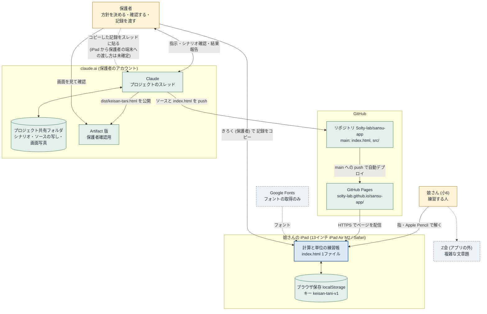
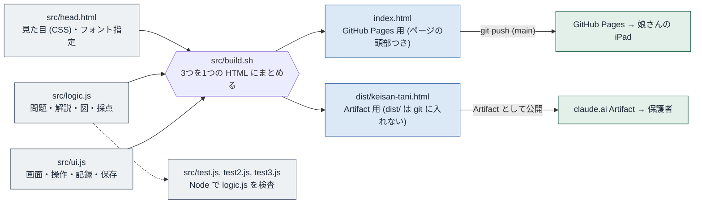
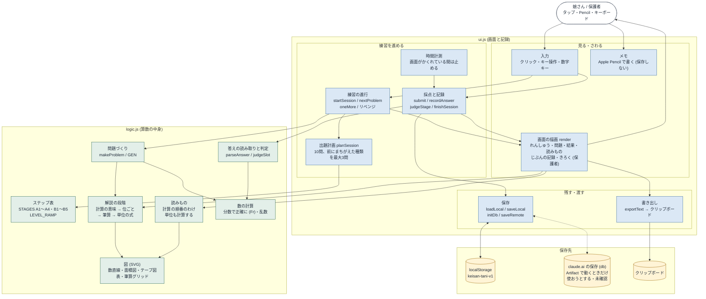
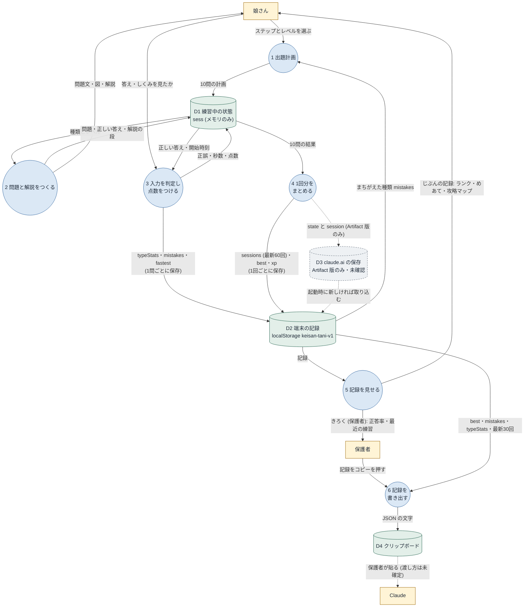

# 計算と単位の練習帳 構造図

作成: 2026-11-03 / 対象: リポジトリ Solty-lab/sansu-app の main (コミット 7aa9814, アプリ v1.7)

この文書は、アプリの構造を理解し、問題が起きたときに「どこで何が起きているか」を切り分けるための図です。図は3種類あります。

1. コンテクスト図: アプリと、端末・サーバー・関係者のつながり
2. ブロック図: アプリの中の機能の配置と、機能どうしのデータの流れ
3. データフロー図: 記録 (データ) がどこで生まれ、どこに保存され、誰に届くか

各図の後に、根拠にしたコードの場所と、コードで確認できなかった点 (推測) を分けて書いています。

図は Mermaid で書いています (GitHub ではそのまま図として表示されます)。Mermaid を表示できない画面のために、同じ図の画像を `img/` に置いています: `1-context.png`, `2-1-build.png`, `2-2-blocks.png`, `3-dataflow.png` (拡大しても崩れない `.svg` もあります)。

---

## 0. 確かめ方と、確かさの区別

| 区別 | 意味 |
|---|---|
| 確認済み | ソースコード、ビルド結果、GitHub のデプロイ記録で確かめたこと |
| 推測 | コードからは確かめられないこと。iPad の実機や Safari の挙動、運用の実態など |

確認に使ったもの:

- ソース: `src/head.html`, `src/logic.js`, `src/ui.js`, `src/build.sh` (リポジトリと /mnt/project-files/app/src/ の写しは同一)
- `sh src/build.sh` を実行し、出来た `index.html` がリポジトリの `index.html` と同一であること、`dist/keisan-tani.html` が /mnt/project-files/app/keisan-tani.html と同一であることを確認
- /mnt/project-files/app/standalone/index.html はリポジトリの `index.html` と同一
- GitHub のデプロイ記録: 環境 `github-pages` に 7aa9814 が 2026-10-20 23:51 (UTC) にデプロイ済み
- シナリオ: /mnt/project-files/scenario/scenario-v1.7.md

確認できなかったもの:

- 公開ページ https://solty-lab.github.io/sansu-app/ の実際の表示 (Claude の環境からは接続できない)
- 娘さんの iPad (Safari) 上での動作、保存の持ち方
- 保護者確認用 Artifact で claude.ai への保存 (window.claude の db) が実際に動いているか (シナリオ 5.1 でも「未確認」)

---

## 1. コンテクスト図 (端末・サーバー・関係者)

### 図の読み方

- 娘さんが使うのは GitHub Pages で公開された `index.html` だけです。娘さんは年齢制限で claude.ai を使えないため、claude.ai を通りません。
- アプリは 1 ファイルで完結し、サーバー側の処理 (ログイン、データベース、API) はありません。GitHub Pages はファイルを配るだけです。
- 練習の記録は、娘さんの iPad のブラウザの中 (localStorage) にだけ保存されます。ネットワークには送られません。
- Claude に記録を届ける方法は、保護者が「記録をコピー」して、プロジェクトのスレッドに貼ることだけです。
- 保護者確認用の Artifact は、同じアプリの別の配り方です。Artifact と娘さんの iPad の記録はつながっていません。

### 関係者と役割

| 関係者・装置 | 役割 | 確かさ |
|---|---|---|
| 娘さん | Pages 版で練習する。「じぶんの記録」で自分の伸びを見る | 運用の取り決め (シナリオ) |
| 保護者 | 方針の指示、シナリオと Artifact の確認、記録のコピーと受け渡し、GitHub Pages の設定 | 運用の取り決め |
| Claude | ソースの作成・ビルド・push、Artifact の公開、記録の分析、シナリオの更新 | 運用の取り決め |
| GitHub リポジトリ | ソース (`src/`) と公開用 `index.html` の置き場 | 確認済み |
| GitHub Pages | main の root を配信。push のたびに自動デプロイ | デプロイ記録で確認済み。設定画面は Claude から見えない |
| 娘さんの iPad | ページの実行と記録の保存 | 実機では未確認 |
| Google Fonts | 見た目のためのフォントを取得する。記録は送らない | 確認済み (`src/head.html` 3〜5行目)。通信できないときは端末のフォントで表示される (推測) |
| claude.ai Artifact | 保護者が中身を確認するための版 | 公開済み (メモリの記録)。claude.ai 保存の動作は未確認 |

---

## 2. ブロック図 (機能の配置とデータの流れ)

### 2-1. ビルドと配布

- `index.html` と `dist/keisan-tani.html` の中身 (CSS とスクリプト) は同じで、違いは `index.html` に `<!doctype html>` やホーム画面用の `<meta>` が付くことだけです (`src/build.sh`)。
- `src/` を直したら、`sh src/build.sh` で `index.html` を作り直してから push しないと、娘さんの画面は変わりません。

### 2-2. ページの中の機能配置

### 機能とコードの場所

| 機能 | 主な関数・定義 | 場所 |
|---|---|---|
| 数の計算 (分数で正確に) | `Fr`, `gcd`, `lcm` | `src/logic.js` 1〜46行 |
| 答えの読み取り・判定 | `parseAnswer`, `judgeSlot` | `src/logic.js` 89〜114行 |
| 筆算グリッド | `addSubFrames`, `mulFrames`, `longDivFrames`, `gridHTML` | `src/logic.js` 115〜394行 |
| 図 (SVG) | `figNumberLine`, `figArea`, `figDoubleLine`, `figTapes` など | `src/logic.js` 395行〜 |
| ステップ表 | `STAGES`, `LEVEL_RAMP`, `TRACKS`, `TYPE_NAMES` | `src/logic.js` 567〜602行 |
| 読みもの | `LESSONS` (order, unit) | `src/logic.js` 1700行 |
| 問題づくり | `makeProblem` (中で `GEN[type]` を呼ぶ) | `src/logic.js` 1705行 |
| 保存 | `LS_KEY`, `loadLocal`, `saveLocal`, `initDb`, `saveRemote` | `src/ui.js` 1〜87行 |
| 出題計画 | `planSession` | `src/ui.js` 97行 |
| 練習の進行 | `startSession`, `nextProblem`, `oneMore` | `src/ui.js` 123〜201行 |
| 採点と記録 | `submit`, `recordAnswer`, `judgeStage`, `finishSession` | `src/ui.js` 151〜239行 |
| 画面 | `homeHTML`, `practiceHTML`, `resultHTML`, `mineHTML`, `parentHTML`, `lessonHTML`, `render` | `src/ui.js` 241〜517行 |
| 書き出し | `exportText`, ボタン `copy` | `src/ui.js` 461行, 606行付近 |
| メモ (Pencil) | `class Memo` | `src/ui.js` 519〜567行 |
| 時間計測 | `elapsed`, `visibilitychange` | `src/ui.js` 25行, 626行 |

---

## 3. データフロー図 (記録の生まれ方・保存先・届き方)

### 保存されるデータ (D2 localStorage, キー `keisan-tani-v1`)

`src/ui.js` の `freshState()` と `recordAnswer()`, `finishSession()` から読み取った中身です。

| 項目 | 中身 | いつ書かれるか |
|---|---|---|
| `v` | データ形式の版 (今は 2)。古い形式 1 は `migrate()` で変換 | 起動時 |
| `updatedAt` | 最後に更新した時刻 | 1問ごと・1回ごと |
| `typeStats` | 種類ごとの 回数・正解数・しくみを見た数・見直した数 | 1問ごと |
| `mistakes` | 「種類:レベル」ごとのまちがい度 (0〜3)。次の出題に使う | 1問ごと |
| `fastest` | 「種類:レベル」ごとの最速正解タイム | 1問ごと |
| `best` | コースごとのいちばんよい結果 (正解数・点数・メダル・タイム) | 10問を最後まで答えたとき |
| `sessions` | 練習1回ずつの明細 (問題・入力・正誤・秒数)。最新60回まで | 1回の終わり (途中でやめたときも) |
| `xp` | 点数の合計 (ランクに使う) | 1回の終わり |
| `finger` | メモに指で書けるか | 切り替えたとき |
| `unlocked` | 昔の「段階をひらく」方式の名残。今は使われていない | 初期値のみ |

保存されないもの: メモ (Pencil で書いた線)、練習中の途中経過 (`sess`)。ページを閉じると消えます。ただし解いた問題の正誤は1問ごとに D2 に入ります。

### 書き出し (「記録をコピー」) の中身

`exportText()` (`src/ui.js` 461行): 先頭に「計算と単位の練習帳 記録」の1行、続けて JSON。中身は `best`, `mistakes`, `typeStats` と最新30回の練習 (各問題は 種類・正誤・しくみ・秒数・問題・入力・答え)。自動コピーに失敗したときは、画面に文字の欄が出て手で選んでコピーします。

---

## 4. 構造から見える注意点と、困ったときの切り分け

| 起きそうなこと | 理由 | 確かさ | 対処の候補 |
|---|---|---|---|
| 直したのに娘さんの画面が変わらない | `index.html` を作り直していない / Pages のデプロイ待ち / Safari のキャッシュ | 前2つは構造上確実。キャッシュは推測 | GitHub の Deployments で最新コミットが出ているか見る。Safari で再読み込み |
| 記録が消えた | 記録は iPad のブラウザの中にしかない。Safari の履歴・Webサイトデータを消すと消える | 構造上確実 | こまめに「記録をコピー」で控えを取る |
| しばらく使わないと記録が消える | Safari は、ホーム画面に追加していないサイトの保存データを、7日間そのサイトを使わないと消すことがある | 推測 (Safari の仕様として知られているが、この iPad・iPadOS 27 では未確認) | 定期的に記録をコピーする。ホーム画面に追加して使う |
| Safari とホーム画面のアイコンで記録が違う | ホーム画面に追加したページは、Safari とは別の保存場所を持つことがある | 推測 (実機未確認) | 使う入口をどちらか1つに決める |
| Artifact で試した記録が娘さんの iPad に出ない | Artifact 版と Pages 版は保存場所が別。Pages 版では claude.ai の保存は使われない (`window.claude` がないため) | コード上確認済み | 仕様どおり。娘さんの記録は Pages 版のものだけを見る |
| ネットにつながらないと開けない | オフラインで動かす仕組み (Service Worker) がない | コード上確認済み (登録処理がない)。一度開いたページが残るかは推測 | Wi-Fi のある場所で開く |
| 記録を Claude に渡せない | コピーは娘さんの iPad のクリップボードに入る。保護者の端末への移し方は決まっていない | 運用上の未決事項 | 例: 娘さんの iPad でメモに貼って AirDrop、保護者がその iPad で claude.ai を開く、など。運用を決める必要がある |
| 文字の形が違って見える | フォントは Google Fonts から読む。読めないと端末のフォントになる | 構造上確実 | 動作には影響しない |

README には「外部に送るデータはありません」とあり、記録についてはコード上その通りです。ただしフォント取得のために Google のサーバーへの通信は発生します (記録は含みません)。

---

## 5. この図を更新するとき

- `src/ui.js` の保存キー (`LS_KEY`) や `freshState()` の項目が変わったら、3章の表を直す。
- 画面 (タブ) が増えたら、2-2 の「画面の描画」と3章の P5 を直す。
- 配り方 (Pages の設定、Artifact) や受け渡しの運用が決まったら、1章と4章を直す。
